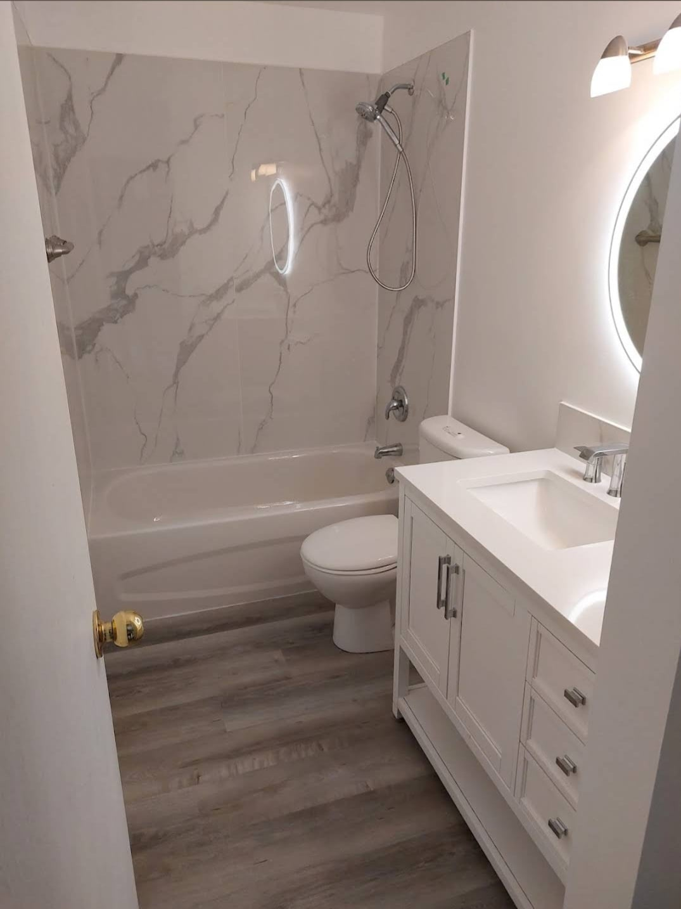

Good news first: porcelain tile is one of the easiest surfaces in a house to keep clean. It is dense, hard and absorbs almost no water, so soap scum and shampoo sit on top instead of soaking in.

The parts that need care are the joints: the grout between tiles (if there is any) and the silicone along the tub and in the corners. Treat those right and the whole surround looks new for years.

## After every shower: 30 seconds

- **Squeegee or wipe the walls.** Water that dries on the tile leaves spots. Water that is wiped off does not. A squeegee hanging on a hook is the single best habit you can have.
- **Run the fan.** Leave it on during the shower and for about 20 minutes after. Mould needs moisture to grow; take the moisture away and most of the problem goes with it.
- **Leave the curtain or door open** so the tub and the corners dry.

## Once a week: 5 minutes

Warm water with a few drops of dish soap, or a pH-neutral bathroom cleaner, and a soft cloth or sponge. Wipe, rinse with clean water, dry. That is it.

Microfibre works well on polished tile because it picks up the film without leaving streaks.

## What not to use

- **Acidic cleaners on grout.** Vinegar, lemon and many "lime and rust" removers dissolve cement grout over time. The tile will be fine; the grout will not. If you have hard water spots, use a cleaner labelled safe for grout, keep it on the tile, and rinse it off quickly.
- **Bleach on coloured grout.** It can leave pale patches. On white grout it is fine now and then, but rinse well.
- **Wax or oil soaps.** They leave a sticky film that actually holds dirt.
- **Scouring powder and green scrub pads on polished tile.** Porcelain is hard, but a polished surface can lose some of its shine if you scrub it with abrasives every week. A soft brush is enough for anything that sticks.
- **Anything containing hydrofluoric acid.** It is one of the few chemicals that does attack porcelain. You are unlikely to have it at home, but some heavy-duty rust removers contain it. Read the label.

## The silicone: the part that wears out

The joint between the tile and the tub, and the vertical joints in the corners, are filled with silicone, not grout. That is on purpose: the tub moves a little when it fills with water, and silicone flexes with it.

Silicone does not last forever. Replace it when you see:

- Black spots that are **under** the surface and do not wipe off. That is mould growing inside or behind the silicone. Cleaning will not reach it.
- Edges that have peeled away from the tub or the tile.
- Cracks or gaps.

The job is simple but fussy: cut out the old silicone completely, clean and dry the joint, then run a new bead. Depending on how the bathroom is used, every few years is normal. If you would rather not do it yourself, ask us.

## The grout, if you have it

With large tiles there is very little grout, sometimes none in the field of the wall. Where there is cement grout, a penetrating sealer helps it resist stains. How often depends on the product, so follow what is on the bottle. Epoxy grout does not need sealing.

## A once-a-year look

Once a year, look closely at the bottom row and the corners:

- Is the silicone still tight to the tub along its whole length?
- Any grout cracks?
- Does anything sound hollow when you tap it?

Catching a gap in the silicone early costs a tube of sealant. Catching it after water has been getting behind the wall for two years costs a lot more.

Questions about your surround, or not sure if a stain is on the tile or in it? Send us a photo on WhatsApp and we will tell you what we see.
