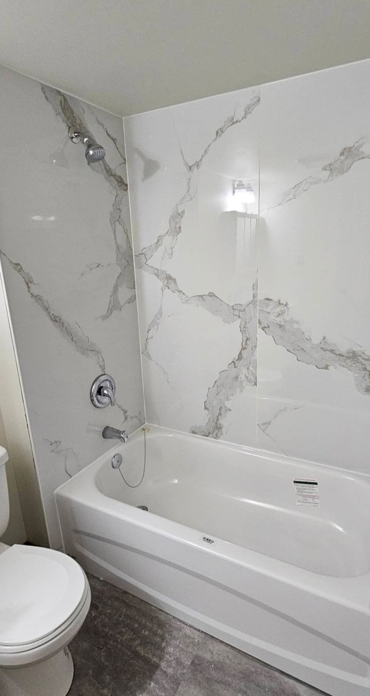

**In short:** plastic panels fade, warp and lose their look over the years. Porcelain tile stays strong, stylish and waterproof. If you want a bathroom that looks modern and lasts for decades, choose tile.

## What "plastic panels" actually are

When people talk about plastic bathroom panels today, they usually mean one of two products:

- **PVC panels:** light, hollow sheets of vinyl, often with a printed stone or tile pattern, glued or clipped to the wall.
- **SPC panels** (stone plastic composite): a denser board made of limestone powder bound with PVC, with a printed decor layer and a thin plastic wear layer on top. Many click together like flooring.

Both are cheap, quick to put up, and the plastic itself does not soak up water. That is why they are popular. The trouble is not the material sitting in water. It is everything else a bathroom wall goes through.

## Where plastic panels fall short

### The look is printed on

The stone pattern on a plastic panel is a photo printed under a thin wear layer. Up close, and in the raking light of a bathroom, it looks like what it is. Natural porcelain has the colour and pattern through a fired surface with real depth, and large tiles can carry a full marble vein across a wall.

### Heat and steam make plastic move

Plastic grows and shrinks with temperature much more than tile does. A hot shower every morning and a cold wall at night, winter after winter, is exactly what makes panels bow, open at the joints or pull away at the edges. Porcelain is fired at over 1,200 °C. A shower is nothing to it.

### Water gets in at the joints, not through the face

A panel is waterproof; a wall of panels is only as good as its joints, corners and edges. When those open up, water runs behind the panel, where you cannot see it. Tile is installed on a backer board made for wet areas, with sealed corners, so even the parts you never see are built for water.

### Soft surface, short life

Plastic scratches and dents. Abrasive cleaners and years of scrubbing leave it dull, and the printed colour can fade. Porcelain is hard enough to resist scratches and stains, and its colour does not change.

### Fire

Porcelain does not burn. PVC does, and it gives off thick smoke when it does. It is not something people think about when choosing a bathroom wall, but it is a real difference.

## Why tile is worth it

- **It lasts.** Properly installed porcelain looks the same in fifteen years as on the day it went up.
- **It looks premium.** Large marble or stone-look tiles change how the whole room feels. Plastic never quite matches natural stone texture.
- **It handles wet zones.** Showers, tubs and steamy bathrooms are what porcelain is made for: no swelling, no peeling.
- **It reads as a finished bathroom.** When people look at a house, a tiled bathroom looks renovated; plastic panels look like a budget fix.
- **Fewer joints than you think.** With large-format tiles, a whole tub surround can take as few as four tiles, so there is very little grout to clean. See [how many tiles your surround needs](/guides/tub-surround-tile-sizes/).

## To be fair to plastic

Panels make sense for some jobs: a quick refresh in a rental, a laundry room wall, a basement you plan to redo later. They are cheaper and faster, and that matters.

But a bathroom wall around a tub or shower takes more water, steam and scrubbing than any other wall in the house. That is where the cheaper option tends to cost more in the end.

## Installation matters as much as the tile

Good tile on a bad wall is still a bad wall. What we pay attention to:

- a backer board made for wet areas behind the tile, not regular drywall;
- straight, aligned joints and clean cuts around taps and niches;
- flexible silicone in the corners and along the tub, where the house moves;
- a 5-year warranty on the porcelain tile.

Your bathroom walls face humidity, water and steam every day. Tile is luxury plus durability; plastic is a short-term compromise.

If you are weighing the two, message us for a free estimate: a couple of photos of your bathroom are enough to start. Or come and see the full-size tiles at the [showroom](/showroom/).

*Canadian Prime Solutions: style you want, price you need.*
