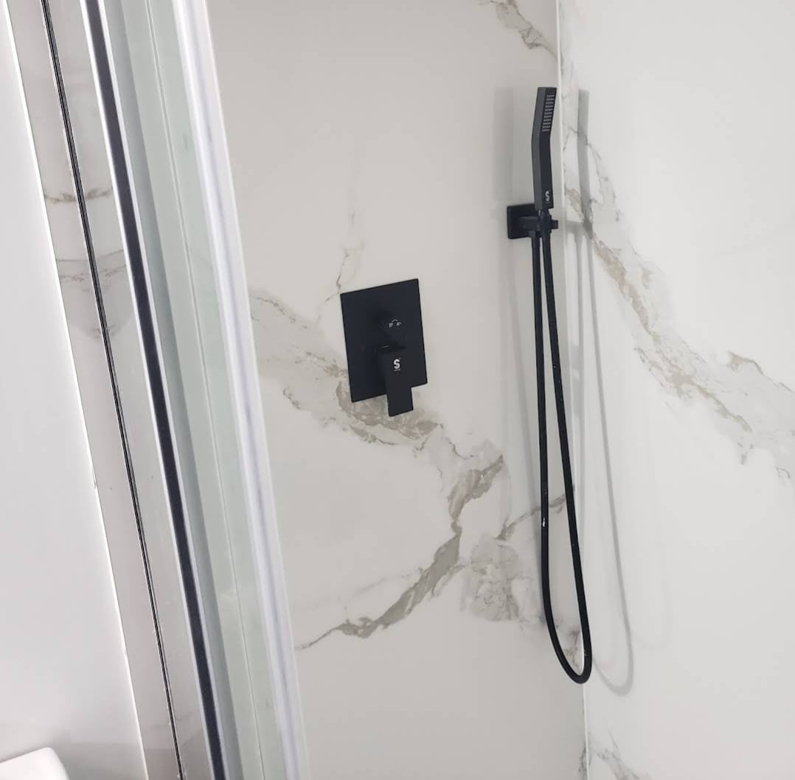

When you replace a tub surround, there are really two families to choose from. Acrylic (or fibreglass) surrounds are plastic panels or one-piece shells, usually white or a plain colour, glued or fastened to the wall. Porcelain tile is fired clay and minerals, the same family as the dishes in your kitchen, bonded to the wall with mortar.

Both keep water out of the wall when they are installed properly. The differences are in how they look, how they age, and what they cost.

## Side by side

| | Acrylic surround | Large porcelain tile |
|---|---|---|
| Material | Plastic (acrylic or fibreglass) | Natural clay and minerals, fired |
| Look | Smooth, plain, often slightly glossy plastic | Stone, marble, concrete; real depth in the pattern |
| Surface | Soft; scratches and dulls over the years | Very hard; resists scratches and stains |
| Colour over time | Can yellow or fade | Does not change |
| Heat | Can be damaged by very hot objects | Not affected |
| Joints | Few or none | Few with large tiles; corners sealed with silicone |
| Install | Fast, lighter, simpler | Needs an experienced installer and more time |
| Cost | Lower | Higher |

## Where acrylic makes sense

Honestly, there are good reasons to choose it:

- **Budget comes first.** It is the cheaper option, both the material and the labour.
- **A rental or a quick refresh before selling.** Nobody expects marble in a basement suite.
- **You just want it white and simple.** If you do not care about pattern, acrylic does the job.

The downsides show up slowly. Acrylic is soft, so abrasive cleaners and years of use leave it dull and lightly scratched. It flexes a little when you lean on it. And if water ever does get behind a panel, you often do not see it until the damage is done.

## Where porcelain makes sense

- **You plan to stay.** Porcelain does not wear out the way plastic does. In ten years it looks the way it did on day one.
- **The bathroom is part of how the house feels.** A wall of real stone look changes the room in a way a plastic panel cannot.
- **Easy cleaning matters.** The surface is hard and absorbs almost no water (porcelain is defined as 0.5% water absorption or less), so soap scum wipes off. With large tiles there are only a handful of joints instead of hundreds of grout lines.
- **You want to keep the old tile.** Thin porcelain can often go [over the existing tile](/guides/tile-over-old-tile/), which skips the demolition.

The downsides are real too. It costs more. It is heavy in large sizes and has to be cut precisely, so it is not a weekend project for most people. And a bad installation on porcelain is still a bad installation: the work behind the tile matters as much as the tile.

## What about small ceramic tile?

That is the third option, and it is how most older surrounds in Winnipeg were done. It can look great, but it means hundreds of grout lines. Grout is the part that stains, cracks and grows mildew. Large-format porcelain gives you the hardness of tile with almost none of that maintenance, which is why it has become popular for surrounds.

## Questions worth asking any installer

Whichever way you go, ask:

1. **What goes behind it?** For tile: a backer board made for wet areas, not regular drywall. For acrylic: whether the wall is checked for damage first.
2. **What happens to the old surround?** Torn out, or covered? If covered, what did they check?
3. **How are the corners and the tub joint sealed?** They should be flexible silicone, not grout.
4. **What is the warranty, and on what?** Material and workmanship are different things. For the record, our tile carries a 5-year warranty.

If you are still between the two, it helps to see porcelain in full size. Pictures make every option look good; a 71″ tile leaning on a wall in front of you is a different experience.
