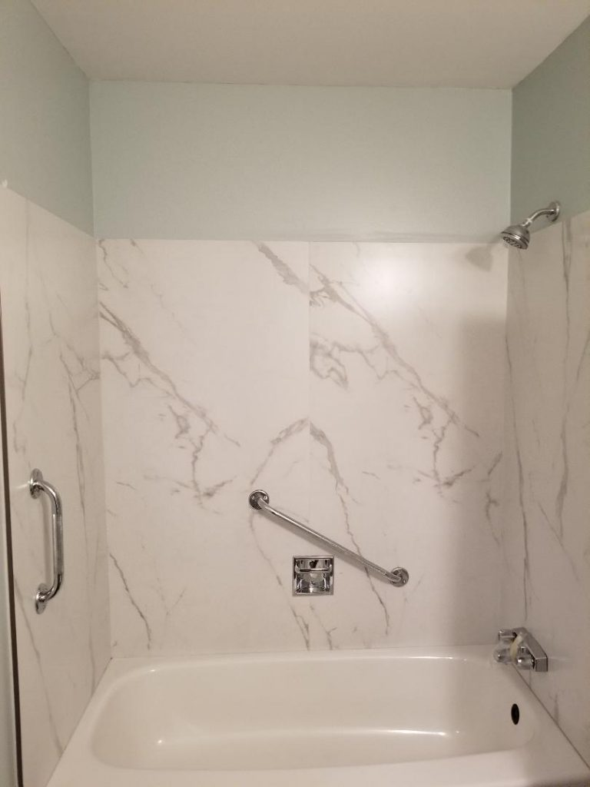

Tearing out an old tub surround is the worst part of the job. It is loud, the dust gets everywhere no matter how much plastic you hang, and you usually find something behind the tile you would rather not have found.

With thin large-format porcelain you can often skip it. The tiles are 1/4″ thick and light for their size, so they can be bonded directly over existing ceramic tile. Often is not always, though. Covering a problem does not fix it, it just hides it for a while.

## Five checks you can do yourself

You need ten minutes, a coin or the handle of a screwdriver, and a long straight edge (a level works).

### 1. The tap test

Tap every tile lightly with the coin. A solid tile gives a sharp, dull click. A tile that has come loose from the wall sounds hollow. One or two hollow tiles high up on the wall are usually not a big deal. A hollow patch near the tub, where the water hits, is a warning sign.

### 2. Press the bottom rows

Push firmly with your thumb on the lowest two rows of tile, especially near the taps and in the corners. If anything moves or feels soft, the wall behind is likely wet. Drywall and old plaster turn to mush when water gets behind the tile for years.

### 3. Look at the caulk and grout along the tub

Black spots under the silicone, gaps in the grout, or caulk that has peeled away from the tub are how water gets in. They do not automatically mean damage, but they tell you where to press harder in check 2.

### 4. Check the other side of the wall

If the wall behind the taps is a closet or a hallway, look at it. Bubbled paint, stains or a soft spot low down on that side mean water has been travelling through the wall. Same for the ceiling below if the bathroom is upstairs.

### 5. Check that the wall is flat

Hold the straight edge against the tile in a few directions. Large tiles do not bend to follow a wavy wall, so any hump or dip shows up as a lip at the seams. The industry standard for large tile asks for no more than 1/8″ of variation over 10 feet. Small dips can be filled. A bowed wall needs more work.

## When it is a good idea

- The old tile is solid and sounds the same everywhere
- No soft spots, no stains on the other side
- The wall is reasonably flat
- You want the job done in days, not a week

In this case the old tile is a good, stable base. It is cleaned and roughened so the mortar grips, and the new tiles are bonded over it.

## When the old tile has to go

- Large hollow areas or loose tiles
- Anything soft when you press it
- Mould behind the tile, not just on the surface of the caulk
- Visible water damage on the other side of the wall

Then the old tile and the damaged wall come out, and the new surround goes onto a proper backer board made for wet areas. It takes longer, but you only do it once.

## What changes when you tile over tile

The wall gets a little thicker: the new tile plus the mortar under it. A few things need planning because of that:

- **Taps and shower valve trim.** The handle and the plate behind it may sit too deep after the new layer. Many valves have extension kits; some older ones do not.
- **Tub spout.** Same thing, it may need a longer nipple.
- **The edges.** Where the tile ends on the outside wall, the old and new layers both show. A metal or stone edge trim makes that edge clean.

None of this is a reason not to do it. It is just the part people forget to ask about until the handle does not reach.

## The short version

If the old tile is solid, the wall is dry and reasonably flat, tiling over it is a sound way to get a new surround fast. Our installs of this kind usually take 2 to 3 days. If something is wrong behind the tile, it is far cheaper to find out before the new porcelain goes up than after.

We do these checks during the visit before we give you a price. If you have done them yourself already, tell us what you found. It helps.
