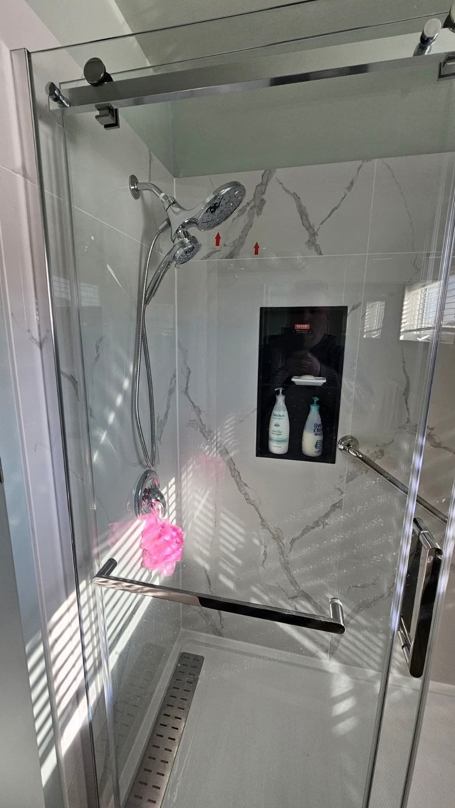

"How much for a tub surround?" is the first question almost everyone asks, and it is a fair one. The problem is that the answer depends on things nobody can see in a sentence: how big the walls are, what is behind the old tile, and what you want around the taps.

That is why we do not publish a price list. Two bathrooms with the same 60″ tub can end up far apart once you look at the walls. Below is what makes the difference.

## 1. How much wall you are covering

A standard alcove tub has three walls: the long back wall and two short end walls. The price starts here.

- **Height.** Tile up to about 6 or 7 feet is the usual. Going all the way to the ceiling adds area and often another row of tile.
- **Width.** Not every tub is 60″. Longer tubs and wider end walls add tile.
- **Extra walls.** A window wall, a half wall or a bulkhead above the tub all count.

The number of tiles matters more than the square footage on its own, because large tiles are bought whole. If a wall needs 1.2 tiles, you pay for 2. Our [guide to tile sizes](/guides/tub-surround-tile-sizes/) shows how many tiles a typical surround needs in each size.

## 2. Which tile you choose

Large-format porcelain comes in several sizes and many designs. The size changes the count of tiles and the number of seams. A 71″ × 36″ tile can cover an end wall in one piece, while smaller tiles mean more pieces and more joints to line up.

The design matters too. Some looks, like bookmatched marble where the veins continue from tile to tile, need tiles in a set order and leave more offcuts.

Seeing the tiles full size helps here. Small samples rarely show how big the pattern really is.

## 3. What is behind the old tile

This one moves the price the most, and it is the hardest to know from photos.

- **Old tile is solid and the wall is dry.** The new tiles can often go straight over it. No tear-out, much less mess, and the job is usually done in 2 to 3 days.
- **Old tile is loose, or the wall is soft or wet.** The old surround and the damaged wall come out, and the new tile goes onto backer board made for wet areas. More labour, more material, more days.

Sometimes the damage only shows up once the old tile is off. A good estimate tells you up front what happens in that case, so it is not a surprise halfway through. Our article on [tiling over old tile](/guides/tile-over-old-tile/) has five checks you can do yourself before anyone visits.

## 4. Edges, corners and walls that are not square

The tile itself is only part of the work. The rest is the details.

- **Outside edges.** Where the tile ends on the bathroom side, the edge needs a trim or a finished stone edge. Longer edges mean more trim.
- **Corners and out-of-square walls.** Older houses rarely have perfectly straight corners. Large tiles show every degree, so the cuts take more time.
- **Window in the tub wall.** The tile has to wrap the window opening, which means extra cuts and trim.

## 5. Niches, shelves and accessories

These are the things people add once they see the plan:

- A built-in niche for shampoo bottles
- Corner shelves
- Grab bars, which need solid backing in the wall
- An accent wall in a different tile

Each one adds a little time and material. A niche usually adds the most, because it is cut into the wall and has to be waterproofed on every side.

## 6. Taps, spout and the valve trim

When new tile goes over old tile, the wall gets a little thicker. The tap handles and the plate behind them may then sit too deep, and the spout may need a longer pipe. Many valves have extension kits; some older ones do not, and then the valve trim or the valve itself may need changing.

If you planned to replace the taps anyway, this is the right moment.

## 7. Getting the tiles into the bathroom

A 71″ tile is about 6 feet long. Narrow stairs, tight turns and small hallways can make carrying it in harder. Plan this before choosing the largest size.

## Things to ask about any quote

Whoever you hire, it is worth knowing what is in the price:

- Is removing the old tile included, or priced only if needed?
- What happens if the wall behind turns out to be damaged?
- Are edge trims, caulking and cleanup included?
- Are the niche and shelves in the price, or extra?
- Who handles the taps and the valve trim?
- How long will the bathroom be out of use?

## How to get a closer estimate from photos

We give the price after a visit, and the estimate is free. If you want a rough idea first, send us:

1. One photo of the whole tub area, taken from the doorway
2. A close-up of the taps and the spout
3. A photo of the outside edge, where the tile ends
4. The width and height of each wall, roughly is fine
5. Anything you already know: loose tiles, a soft spot, a window, a niche you want

With these we can usually tell you what we see and which way the job is likely to go. The visit then confirms it.

## The short version

The size of the walls and the tile you choose set the base. What is behind the old tile decides whether the job stays simple or grows. The details, like edges, niches and taps, fill in the rest. Knowing these before the visit makes the estimate faster and the price easier to understand.
