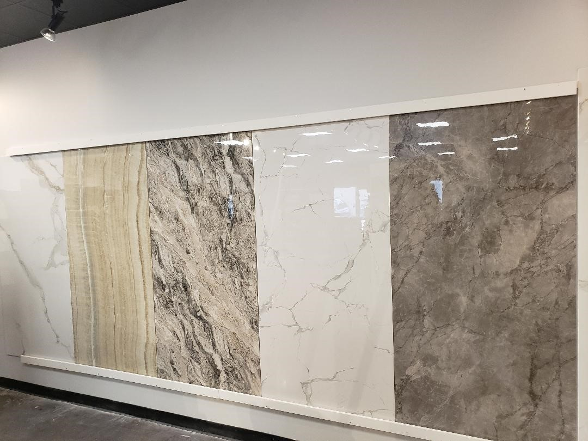

Most people start with the look: Calacatta, onyx, grey stone. That part is easy, you will know it when you see it. The size is the decision that quietly changes everything else, so it is worth five minutes with a tape measure before you fall in love with a pattern.

## Start with your walls, not the tile

A standard alcove tub in Canada is 60″ long and 30″ to 32″ deep. That gives you three walls to cover:

- **Back wall:** about 60″ wide
- **Two end walls:** about 30″ to 32″ wide each
- **Height:** most surrounds stop around 72″ above the tub. If you want to go all the way to the ceiling in a room with 8-foot ceilings, plan for roughly 80″.

Measure yours. Older Winnipeg houses are full of tubs that are an inch or two off, and walls that are not quite square. Write down the width of each wall at the top and at the bottom, and the height from the tub edge to where you want the tile to stop.

## The three common sizes, wall by wall

These numbers assume the 60″ tub above, tiles placed vertically, and a surround that stops at about 72″.

| | 24″ × 48″ | 36″ × 71″ | 47″ × 106″ |
|---|---|---|---|
| Area of one tile | 8 sq ft | 17.7 sq ft | 34.6 sq ft |
| End walls | 2 columns, plus a horizontal joint | 1 tile each, no joints | 1 tile each, no joints |
| Back wall | 3 columns, plus a horizontal joint | 2 tiles, 1 vertical joint | 2 tiles, 1 vertical joint |
| Tiles for the whole surround | about 8 to 10 | 4 | 3 or 4 |
| Goes to the ceiling in one piece | No | No (71″ max) | Yes |

### 24″ × 48″: the flexible one

This size behaves more like traditional tile. You will have joints both ways, but each piece is light enough for one person to carry and set. It also fits in any car.

It makes sense for showers with lots of corners, niches and windows, or if you are doing the work yourself. The trade-off is simple: more pieces, more joints, more grout to keep clean.

### 36″ × 71″: the sweet spot for most tubs

One tile covers an entire end wall, top to bottom, with no joints at all. The back wall takes two tiles with a single vertical seam. That is the whole surround in **four tiles**, and four is also the number at which [delivery in Winnipeg is free from our showroom](/showroom/).

A tip on that back seam: you have two choices. Put one full 36″ tile and a 24″ piece side by side, or cut both to 30″ so the seam sits exactly in the middle. The centred seam looks deliberate, especially with a marble pattern where the veins can be lined up. An off-centre seam is the one people notice.

The limit is height. At 71″ the tile stops a little below most ceilings. That is normal for a tub surround, but if you want floor-to-ceiling, look at the next size.

### 47″ × 106″: floor to ceiling, almost no joints

At 106″ tall this tile covers any normal wall height in one piece. End walls take one tile each and still leave a long strip of about 15″ that can become the back of a niche or a shelf.

The back wall is the same story as before: two pieces with one seam. If you are fine with the seam off-centre, you can sometimes get the back wall from one full tile plus a strip cut from an end-wall offcut, which brings the job down to **three tiles**. For a centred seam, plan for four.

Before you choose this size, check the route. A 106″ tile is almost nine feet long and needs to get from the truck to your bathroom: through the front door, around the corner at the top of the stairs, into a bathroom door that is often 28″ wide. We look at this during the visit. Sometimes the answer is 36″ × 71″ simply because the big one will not make the turn.

## Seams you cannot avoid

Even with the biggest tiles there are always joints in the two back corners and along the tub. Those are not grout lines. They are filled with a flexible silicone sealant, because the walls and the tub move slightly as the tub fills and empties. Rigid grout in those spots cracks.

## A quick way to decide

- **You want the fewest joints and your ceiling is not too high:** 36″ × 71″
- **You want tile to the ceiling, or you have a tall window or a niche:** 47″ × 106″, if it can get into the room
- **Lots of corners, a small shower, or a DIY project:** 24″ × 48″

All three are the same material: natural porcelain, 1/4″ thick. If you are not sure, come and stand in front of the full-size tiles at the showroom. Seeing a 106″ marble-look tile leaning on a wall changes most people's minds one way or the other.

We measure every bathroom before quoting, so you do not need exact numbers to get started. Rough wall sizes and a couple of photos are enough for a first answer.
